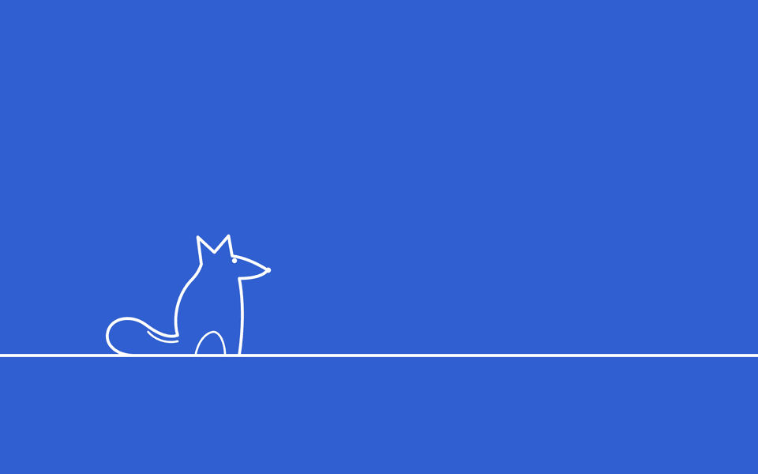

# todo-pane

Your Microsoft To Do tasks in a pane beside the Claude chat. You don't need another app or another tab.



## Why I built this

I work on a 13-inch laptop. My day was spread across a browser full of tabs and a To Do app running in the background. Every switch pulled me out of what I was doing for a moment, and the extra app took RAM it didn't need.

Most of my work already happens in Claude, so I brought the list there. Now my tasks sit next to the conversation. I can see what's overdue without leaving the chat, and one click ticks a task off. That's one app and one tab fewer, so my laptop and my head both have more room.

It's a small thing, and it changed my day more than I expected. If you work the same way, here it is.

## What it does

- **Overdue / today** comes first, oldest first. Dates are red when late and amber when due today.
- **Important** lists starred tasks.
- **Lists** shows every list that has open tasks. Click one to expand it.
- **○** completes a task in Microsoft To Do itself, so the change syncs to your phone too.
- **↻** refreshes. The pane also refreshes on its own every 5 minutes.
- **`/todo`** reopens the pane if you closed it.

## Install

**1. Connect Microsoft To Do to Claude Code.** This plugin talks to To Do through [jordanburke/microsoft-todo-mcp-server](https://github.com/jordanburke/microsoft-todo-mcp-server). Set it up by following its README, then register it in Claude Code under the name `microsoft-todo`:

```bash
claude mcp add microsoft-todo -s user -- node /path/to/microsoft-todo-mcp-server/dist/cli.js
```

Run `/mcp` in Claude Code to check that `microsoft-todo` shows as connected.

**2. Install the plugin** at the prompt of a Claude Code session:

```
/plugin install todo-pane --marketplace mehmetbulut-369/claude-todo-pane
```

Answer `y` to add the marketplace, then choose a scope (`user` makes it available in all your sessions).

**3. Start a new session.** The pane opens by itself.

## How it works

`todo-pane` is a Claude Code plugin made of one hooks module ([`hooks/register.tsx`](hooks/register.tsx)), about 130 lines.

- At session start it opens a pane and calls the `microsoft-todo` MCP server through Claude Code's own connection (`$.mcp.call`). No tokens or credentials are stored in the plugin.
- It reads your lists, then fetches the open tasks of each list in parallel.
- The MCP server returns plain text, which [`hooks/parse.ts`](hooks/parse.ts) turns into tasks.
- Completing a task calls the server's `update-task` with `status: completed`.

Network traffic goes only to Microsoft Graph, through the MCP server you already trust. The plugin does not talk to anything else.

## Limitations

- Tested in the Claude desktop app (Code tab) on macOS. In the terminal, the pane docks beside the chat only in fullscreen at 110+ columns. Elsewhere it sits above the prompt.
- Due dates are read from the server's text output, which uses US date format (`11/20/2026`). If the server ever changes that format, dates won't show up, but tasks still will.
- At most 100 open tasks per list.
- The pane can show and complete tasks. Use To Do itself to add or edit them.

## Development

```bash
claude plugin validate .
claude plugin test .
```

To work on it locally, run `claude --plugin-dir .`. The plugin hot-reloads while you edit.

The demo above is plain HTML with CSS animations ([`assets/demo.html`](assets/demo.html)), recorded frame by frame with headless Chrome ([`assets/record.mjs`](assets/record.mjs), no npm packages needed) and encoded with ffmpeg:

```bash
node assets/record.mjs /tmp/frames 30 10
ffmpeg -framerate 30 -i /tmp/frames/%04d.png -vf "scale=1280:-2,format=yuv420p" -c:v libx264 -crf 20 assets/demo.mp4
```

## License

MIT
